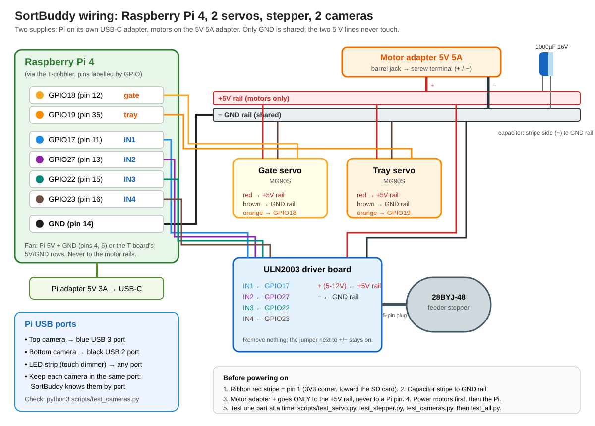

# Wiring: Pi 4, two servos, stepper



Two separate power supplies. The **Pi** runs on its own USB-C 5V 3A adapter.
**Motors** run on the 5V 5A adapter. The two **grounds are joined** and the two
**5 V lines are never joined**.

```
             5V 5A adapter
                  |
           barrel jack (screw terminal)
            +  |        | -
               v        v
   breadboard  [+ rail]  [- rail]------------------------+
                  |  ||     |                            |
                  | 1000uF  |  (stripe/short leg to -)   |
                  |  ||     |                            |
     +------------+---------+---------------+            |
     |                      |               |            |
  gate servo           tray servo       ULN2003 board    |
  red  -> + rail       red  -> + rail   + -> + rail      |
  brown-> - rail       brown-> - rail   - -> - rail      |
  orange-> GPIO18      orange-> GPIO19  IN1 -> GPIO17    |
           (pin 12)             (pin 35) IN2 -> GPIO27   |
                                         IN3 -> GPIO22   |
                                         IN4 -> GPIO23   |
                                                         |
   Pi GND (pin 14, through the T-cobbler) ---------------+   <- the one shared ground
```

## Pi header pins used

| Pin | Name   | Goes to |
|-----|--------|---------|
| 12  | GPIO18 | gate servo signal (orange/yellow) |
| 35  | GPIO19 | tray servo signal |
| 11  | GPIO17 | ULN2003 IN1 |
| 13  | GPIO27 | ULN2003 IN2 |
| 15  | GPIO22 | ULN2003 IN3 |
| 16  | GPIO23 | ULN2003 IN4 |
| 14  | GND    | breadboard − rail (shared ground) |
| 4 / 6 | 5V / GND | the case fan (as before, or on the T-board's 5V/GND) |

On the T-cobbler board the pins are labelled by **GPIO number**
(GPIO18, GPIO19, …), so read the labels and ignore the pin positions.

## Rules

1. **Never connect the 5V 5A adapter to the Pi's 5V pins.** Two supplies
   fighting can damage the Pi. Only GND is shared.
2. **Check the T-cobbler ribbon orientation before powering on.** The red
   stripe on the ribbon goes to **pin 1**, the corner of the header nearest the
   SD card, marked 3V3. Send a photo if unsure.
3. **The servo signal wire** is orange or yellow. Brown or black is ground, and
   red (the middle wire) is 5V.
4. **The capacitor's stripe** (the shorter leg) goes to the **− rail**.
   Backwards, it can pop.
5. **Wire with everything unplugged**, then check, then power the motors,
   then the Pi.

## Test, one part at a time

Test scripts, in `scripts/` (each explains itself at the top):

| Script | Tests |
|---|---|
| `python3 scripts/test_servo.py gate` | gate servo: sweep, then nudge it by hand to find its angles (`m closed`, `m open` to note them) |
| `python3 scripts/test_servo.py tray` | tray servo, the same (`m level`, `m yes`, `m no`) |
| `python3 scripts/test_stepper.py` | stepper: quarter turn and back, then try distances and speeds |
| `python3 scripts/test_cameras.py` | lists cameras by USB port, format, fps, focus score, saves snapshots; `--live` for a live view while focusing |
| `python3 scripts/test_both_cameras.py` | both cameras at once, the way the machine uses them |
| `python3 scripts/test_all.py` | guided check of everything, asking before each step |

Or the same from SortBuddy:

```
sortbuddy hw servo gate          # sweeps 90 -> 60 -> 120 -> 90
sortbuddy hw servo tray
sortbuddy hw servo gate --angle 30
sortbuddy hw stepper --turns 0.25
sortbuddy hw stepper --turns -0.25
sortbuddy hw cameras             # lists both cameras by USB port, saves a snapshot of each
sortbuddy hw cycle               # yes / no / ? motions in order
```

Add `--fake` to any of these to try it on the PC without hardware.

**If a servo twitches or buzzes**, check that hardware PWM is enabled (see
`docs/PI_SETUP.md`, step 4), and that the capacitor is on the rails. **If the
stepper only vibrates and doesn't turn**, two of the IN wires are swapped:
check the order 17, 27, 22, 23.
